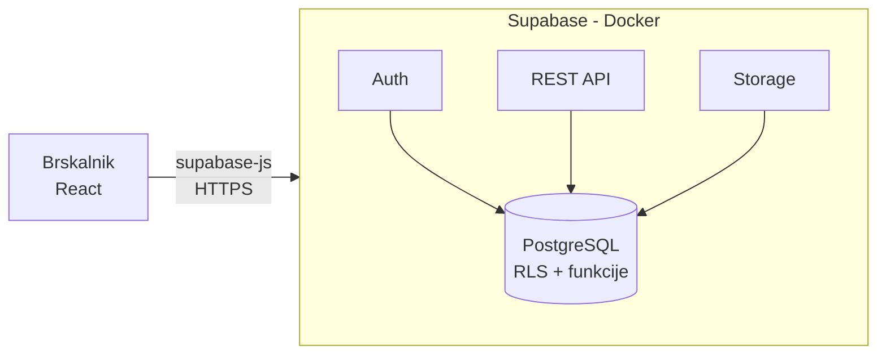

# 04 – Arhitektura in tehnološki sklad

## Arhitektura

### Glavni deli sistema
- **Frontend:** React, ki teče v brskalniku.
- **Supabase** (backend kot storitev):
  - **Auth** – prijava in registracija,
  - **API** (PostgREST) – branje in pisanje podatkov,
  - **Storage** – fotografije,
  - **PostgreSQL** – baza z RLS politikami in funkcijami.



### Komunikacija
Frontend komunicira neposredno s Supabase prek knjižnice `supabase-js`, lastnega strežnika ni:
- navadno branje in pisanje podatkov gre prek REST API-ja,
- spremembe statusa (delovni proces) gredo prek Postgres funkcije `transition_issue`, ki preveri vlogo in dovoljen prehod ter v isti transakciji zapiše zgodovino in obvestilo,
- pravice (kdo vidi in spreminja kaj) določajo **RLS politike** na podlagi tabele `memberships`,
- slike se naložijo v Storage, v bazo se shrani pot.

### Avtentikacija
**Supabase Auth** (e-pošta in geslo). Seje upravlja `supabase-js`. Vloga uporabnika izhaja iz tabele `memberships`, administrator pa iz polja `profiles.is_admin`.

### Podatkovna baza
**PostgreSQL** (v sklopu Supabase). Shema je v migracijah v mapi `supabase/migrations`.

### Lokalni zagon
Potrebna sta Docker in Node.js. Supabase CLI zažene vse storitve v Dockerju.

```bash
npm install
npx supabase start       # zažene Supabase v Dockerju
npx supabase db reset    # migracije + testni podatki (seed.sql)
cd frontend && npm install && npm run dev   # http://localhost:5173
```

Administrator se ustvari tako, da se po registraciji v Supabase (`http://localhost:54323`) nastavi `is_admin = true`.

Struktura repozitorija: `/frontend`, `/supabase` (migracije, seed, konfiguracija), `/docs`.

### E-poštna obvestila (Resend)
Poleg obvestil v aplikaciji (F10) sistem uporabnike obvešča tudi po e-pošti prek storitve **Resend** (F15).

- **Sprožitev:** ob vnosu v tabelo `notifications` Database Webhook pokliče Supabase Edge Function `send-email`.
- **Pošiljanje:** funkcija prebere e-naslov prejemnika in prek Resend API pošlje sporočilo (naslov prijave, nov status, povezava na prijavo).
- **Ključ:** `RESEND_API_KEY` je shranjen kot Supabase secret in ni dostopen frontendu.
- **Lokalno:** funkcija teče z `npx supabase functions serve` (Docker); ključ je v `supabase/functions/.env`.
- **Omejitev:** brez preverjene domene Resend pošilja samo na e-naslov lastnika računa (pošiljatelj `onboarding@resend.dev`). Za prikaz zadošča lasten račun, za druge prejemnike je treba preveriti domeno.

---

## Tehnološki sklad

| Področje | Tehnologija |
|---|---|
| Frontend | React, Vite, TypeScript, React Router, supabase-js |
| Backend | Supabase (PostgREST API, Postgres funkcije, RLS) |
| Podatkovna baza | PostgreSQL (Supabase) |
| Avtentikacija | Supabase Auth (e-pošta in geslo) |
| Shramba datotek | Supabase Storage |
| Lokalni razvoj | Docker, Supabase CLI, Git |

---

## Odločitve
| Odločitev | Utemeljitev |
|---|---|
| **React Vite kot frontend** | Vite ponuja hiter razvojni strežnik, React Router pa omogoča navigacijo med stranmi in zaščito poti po vlogah. |
| **Supabase kot backend** | Baza, prijava in shramba so že vključeni, zato ni lastnega strežnika. |
| **Poslovna logika v Postgres funkcijah** | Pravila poteka statusov so na enem mestu in se izvedejo transakcijsko, ne glede na odjemalca. |
| **Supabase Auth** | Izognemo se lastni implementaciji prijave in ravnanju z žetoni. |
| **PostgreSQL** | Podatki so relacijski, potrebujemo transakcije in tuje ključe. |
| **Docker (Supabase CLI)** | En ukaz zažene enako okolje za vse razvijalce. |
| **TypeScript** | Tipe je mogoče generirati iz sheme baze, kar zmanjša napake pri delu z entitetami. |
| **Resend** | Pošiljanje poteka asinhrono po vnosu obvestila, zato napaka pri pošiljanju ne vpliva na prehod statusa. |