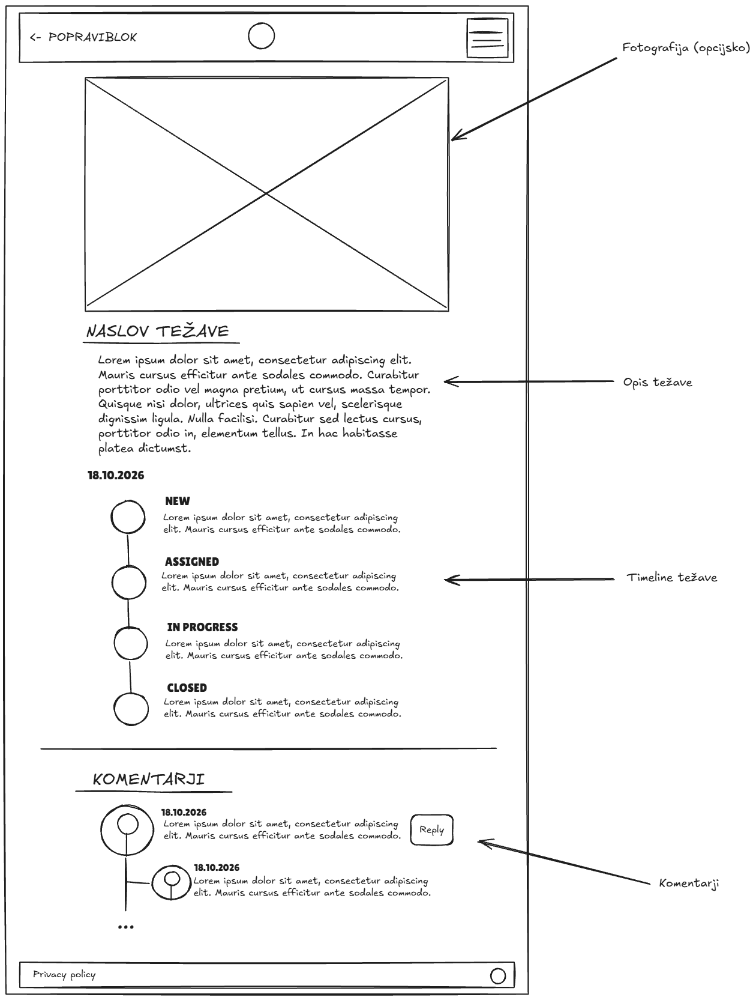
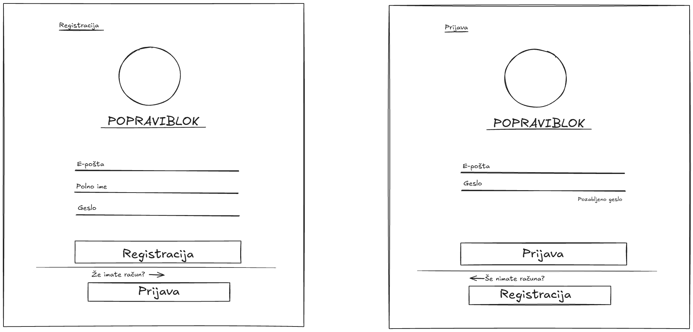
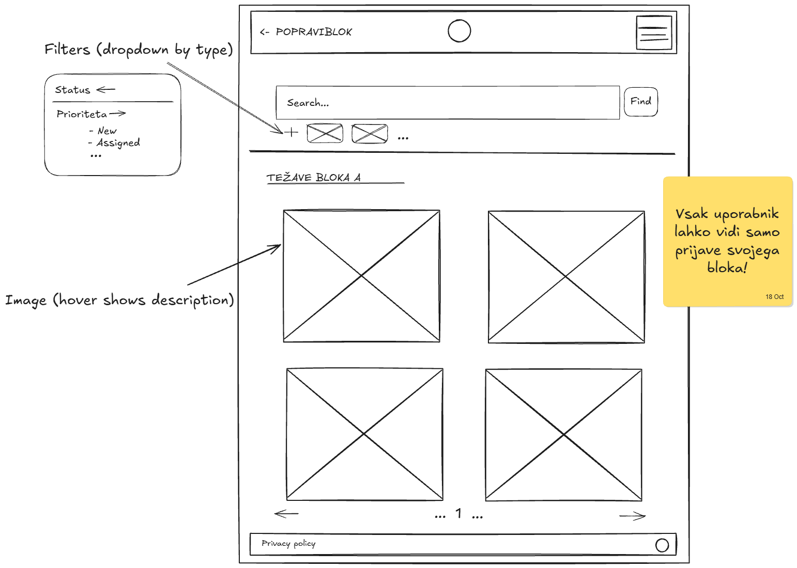

# 06 – Wireframes

## Wireframe 01 – Podrobnosti težave

Prikaz ene prijave. Na vrhu je neobvezna fotografija težave, sledita naslov in opis ter čas prijave. Nato je časovnica statusov (NEW → ASSIGNED → IN_PROGRESS → CLOSED idr.), ki kaže potek obravnave, na koncu pa so komentarji udeležencev.  
---

## Wireframe 02 – Registracija in prijava

Zaslon vsebuje dva ločena obrazca. Registracija ima polja e-pošta, ime in geslo, prijava pa e-pošto in geslo. Pod obrazcema sta povezavi za preklop med njima: "Že imate račun?" odpre prijavo, "Še nimate računa?" pa registracijo.  
---

## Wireframe 03 – Pregled težav bloka

Seznam težav bloka, katerega vsebina je prilagojena vlogi prijavljenega uporabnika:

- **Stanovalec** najprej vidi svoje prijave, prijave drugih stanovalcev bloka (v obravnavi ali zaključene) lahko prikaže s filtri.
- **Upravnik** najprej vidi nove prijave stanovalcev, z uporabo filtrov lahko pregleda tudi vse ostale prijave, ki so v obravnavi ali zaključene.
- **Serviser** vidi samo prijave, ki so mu dodeljene.
